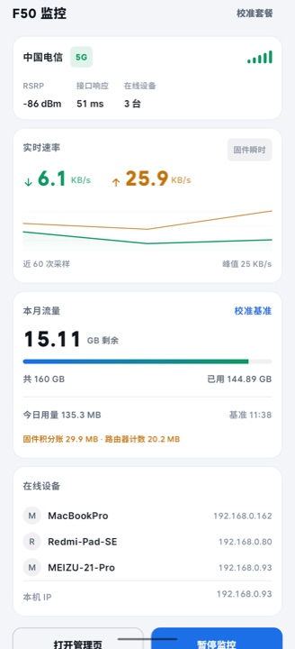
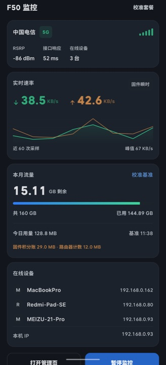
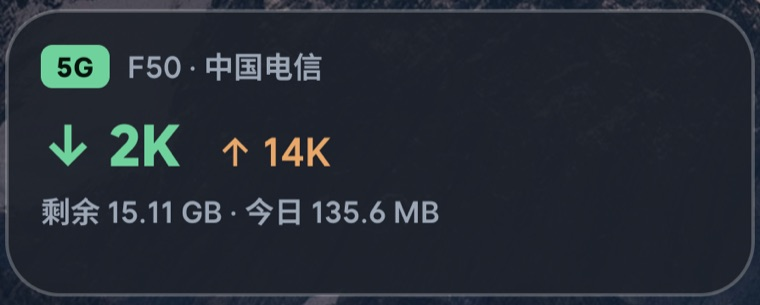

# F50 监控 · Android 端

F50 随身路由（中兴 F50）的 Android 客户端：前台服务定时抓取路由器状态，展示速率、剩余流量、在线设备，并提供桌面小组件与常驻通知。跟随系统深浅色。

## 截图

| 浅色 | 深色 |
| --- | --- |
|  |  |

3×1 桌面小组件（浅 / 深）：

| 浅色 | 深色 |
| --- | --- |
|  |  |

## 当前状态（2026-11-27）

**已在魅族 21 Pro（Android 16 / SDK 36）上跑通全部功能，真机完成流量口径标定，release 包已签名产出。**

已完成：

- M1 算法库：`UsageCalculator`（固件下行瞬时积分，计数器差分仅作诊断）、`QuotaRepository`（校准口径、基准迁移、日用量 90 天）
- M2 采集：`RouterApi`（HttpURLConnection + Referer，字段解析容错）、`NetworkUtil`（Wi-Fi 网络选择与网关发现、`bindProcessToNetwork`）、`MonitorService`（`connectedDevice` 前台服务 + 常驻通知）
- M3 面板：Compose 面板（状态卡 / 实时速率折线 / 套餐进度 / 在线设备 / 设置 / 校准弹窗），`Theme.kt` 双套配色跟随系统
- M4 小组件：`RateWidgetProvider`（服务主动 push，`updatePeriodMillis=0`），`values-night` 深色配色
- 构建：AGP 8.6.1 + Kotlin 2.0.20 + Compose BOM 2024.09.02，`compileSdk 35 / minSdk 26 / targetSdk 35`

已知限制：

- **Flyme 会把整进程冻结**（日志 `am_freeze`），面板/小组件/通知一起定格，冻结期间用量漏记；退出后台后需手动重进应用恢复。
- 开机自启在 Flyme 上实测无效（`BOOT_COMPLETED` 未拉起服务），`BootReceiver` 代码保留但不保证生效。
- `adb install` 若报 `INSTALL_FAILED_USER_RESTRICTED`，点亮并解锁屏幕重试即可。

## 构建 / 安装

```bash
cd android
export JAVA_HOME=$HOME/.local/jdk17
export ANDROID_HOME=$HOME/Library/Android/sdk

~/.local/gradle-8.9/bin/gradle :app:assembleDebug --console=plain
# 产物：app/build/outputs/apk/debug/app-debug.apk

$ANDROID_HOME/platform-tools/adb install -r app/build/outputs/apk/debug/app-debug.apk
$ANDROID_HOME/platform-tools/adb shell am start -n com.leafyin.f50monitor/.ui.MainActivity
```

环境备注：

- JDK：`~/.local/jdk17`（Temurin 17.0.21.1）
- Gradle：`~/.local/gradle-8.9/bin/gradle`（从华为镜像下载，官方源在本机只有 ~30 KB/s）
- SDK：`~/Library/Android/sdk`（platforms android-35、build-tools 34/35、emulator、cmdline-tools、system-image android-35 google_apis x86_64）
- 依赖：AGP / Kotlin / Compose 全在 `~/.gradle` 缓存里，构建基本离线可完成

## 目录

```
android/
├── app/src/main/java/com/leafyin/f50monitor/
│   ├── data/        Models.kt · RouterApi.kt · NetworkUtil.kt
│   ├── domain/      UsageCalculator.kt · QuotaRepository.kt · Fmt.kt
│   ├── service/     MonitorService.kt · MonitorState.kt · BootReceiver.kt
│   ├── widget/      RateWidgetProvider.kt
│   └── ui/          MainActivity.kt · PanelScreen.kt · CalibrationDialog.kt · Theme.kt
├── app/src/main/res/  layout/widget_rate.xml · xml/(network_security_config|widget_info).xml · drawable/*
└── app/build.gradle.kts
```

## 设置项（面板底部）

- 采样间隔：1 / 2 / 5 / 10 秒（默认 2s；间隔直接影响速率显示与积分精度，真机实测 2s 足够）
- GB 口径：`1e9`（与 macOS 版一致）/ `1024³`（对齐运营商账单）
- 网关：留空自动取当前 Wi-Fi 网关，填了就用填的（模拟器调试时填 `192.168.0.1` 可直达 F50）

## 已知取舍

- 明文 HTTP 全局放开（`network_security_config` 的 base-config），因为网关地址可能被用户改成任意私网段；App 代码只请求网关，不请求其他 http 地址。
- 前台服务用 `connectedDevice`，避开 Android 15 对 `dataSync` 的 6 小时限制；依赖 `CHANGE_WIFI_STATE` 权限满足前置条件。
- 小组件不自行轮询，刷新完全由服务 `AppWidgetManager.updateAppWidget` 推送。

## 真机验证（2026-11-27，魅族 21 Pro / Android 16 / SDK 36）

- 安装：Flyme 默认拒绝 `adb install`（`INSTALL_FAILED_USER_RESTRICTED`）。实测**点亮并解锁屏幕**后重装即可通过，不需要改系统开关；锁屏状态下 `adb install` 与 `pm install` 一律被拒。
- 运行：手机连 F50 的 Wi-Fi 后自动取网关 `192.168.0.1`，接口响应 55–160ms；4 台在线设备全部正确显示（坑：`station_list` 是 JSON **数组**不是内嵌字符串，解析已修）。
- 小组件：3×1，拖到桌面后实时刷新——「5G F50·中国电信 / ↓9K ↑112K / 剩余 119.97 GB · 今日 79.6 MB」。
- 常驻通知：2 秒刷新，暂停后服务与通知一起撤掉，恢复后重新拉起。
- 锁屏 150 秒：进程未被杀，采样连续，用量继续累计。
- 开机自启：**不做了**（2026-11-27 用户确认）。BootReceiver 代码保留但不指望它在 Flyme 上生效；App 由用户手动打开即可。

## M0 校准结论（同一台 MU5120 实测，Mac 侧与手机侧一致）

| 场景 | 实际下行 | 固件 realtime 积分 | monthly_rx 计数器增量 |
|---|---|---|---|
| 6.8MB/s 下载 20s | 136MB | 127MB（0.93x） | 1.8MB |
| 6.4MB/s 下载 25s | 136MB | — | 之后 6 分钟只涨 11MB，无补记 |
| 10.5MB 下载 ×3 | 10.5MB | 6.5–9.6MB（0.62–0.91x） | 0.1–0.2MB |
| 限速 64KB/s 下载 60s | 3.9MB | 11.6MB（3x，读端限速导致窗口堆包） | 4.06MB（1.04x） |
| 空载 170s | ≈0 | 9.9KB/s，被 10KB/s 死区挡住 | +1.56MB（9.2KB/s 匀速漂移） |

结论：

1. `monthly_rx_bytes` / `monthly_tx_bytes` 在这台固件上不是真实流量计数器——重负载严重少记、事后不补，空载还会匀速漂移，不能拿来记账。macOS 版「计数器差分即精确值」的假设在真机上不成立。
2. `realtime_rx_thrpt` 可用：高速段 0.93x，单次 10MB 在 0.6–0.9x；被人为限速时会偏高（读端限速让路由器窗口堆包），正常使用不受影响。
3. `realtime_tx_thrpt` 噪声大（空载都能报 100KB/s），记账继续只采信下行（沿用 macOS 版口径）。
4. `realtime_rx_bytes` / `realtime_tx_bytes` 恒为 0，固件没有其他可用的累计字节字段。

因此用量口径改为 **固件下行瞬时积分为主**（扣 4KB/s 基线、10KB/s 死区、`dt>5s` 跳过积分），`monthly` 计数器差分只留作诊断：面板上并排显示「固件积分账 / 路由器计数」，方便和运营商账单对账。

验证：下载 31.5MB 后 App 记账 +32.7MB（1.04x），剩余 120.00 → 119.97，今日 35.8 → 68.4MB，与预期一致。

## 深浅色主题（2026-11-27）

- 跟随系统：`values/themes.xml`（浅）与 `values-night/themes.xml`（深）两套 window 背景/状态栏样式，Activity 重建时由 Compose 的 `isSystemInDarkTheme()` 选调色板（`ui/Theme.kt` 的 `DarkPalette` / `LightPalette`），运行中改系统模式会立即跟随。
- 深色不再是一片黑：背景 `#0A0F16 → #12161C`，卡片 `#131A23 → #1B222B`，边框/分隔线/网格线一起提亮，卡片和背景之间有了层次。
- 状态栏「消失」的根因：原来是系统浅色 + 面板深色，`enableEdgeToEdge()` 按系统模式把状态栏图标画成**深色**，压在近黑背景上等于看不见。现在显式传 `SystemBarStyle.light(...)` / `SystemBarStyle.dark(...)`，图标永远和我们的背景反色；内容区仍保留 `statusBarsPadding()` / `navigationBarsPadding()`，不会被状态栏或手势条挡住。
- 桌面小组件也跟着切：颜色抽到 `res/values/colors.xml` + `values-night/colors.xml`，浅色是半透明白卡片，深色是半透明深卡片，文字/箭头/徽标各自有对比度。


## 构建与发布

```bash
# 调试包
JAVA_HOME=$HOME/.local/jdk17 ANDROID_HOME=$HOME/Library/Android/sdk ./gradlew :app:assembleDebug

# 发布包（签名信息读 keystore.properties）
JAVA_HOME=$HOME/.local/jdk17 ANDROID_HOME=$HOME/Library/Android/sdk ./gradlew :app:assembleRelease
# 产物：app/build/outputs/apk/release/app-release.apk
```

签名说明：

- `keystore.properties`（项目根目录，已 gitignore）四个字段：`storeFile` / `storePassword` / `keyAlias` / `keyPassword`
- 没有该文件时 release 仍可构建，只是没签名（不能上 GitHub Release）
- 当前发布证书：`CN=F50 Monitor, O=leafyin`，SHA-256 `fc64eeeb4fe1106e97d0a457732842634cc0f44638ebbb6f780dfe1e3765dd77`（换了证书就只能卸载重装）
- 签名方案 v2（minSdk 26 够用），APK 约 6.2MB

GitHub：仓库已初始化并打 tag `v0.1.0`，Release 附件用 `f50-monitor-v0.1.0.apk`。

## 下一步

- 上传场景实测一次，决定 tx 是否需要单独系数
- 是否把 macOS 端的用量口径也切到「固件下行瞬时积分」，与手机端统一
